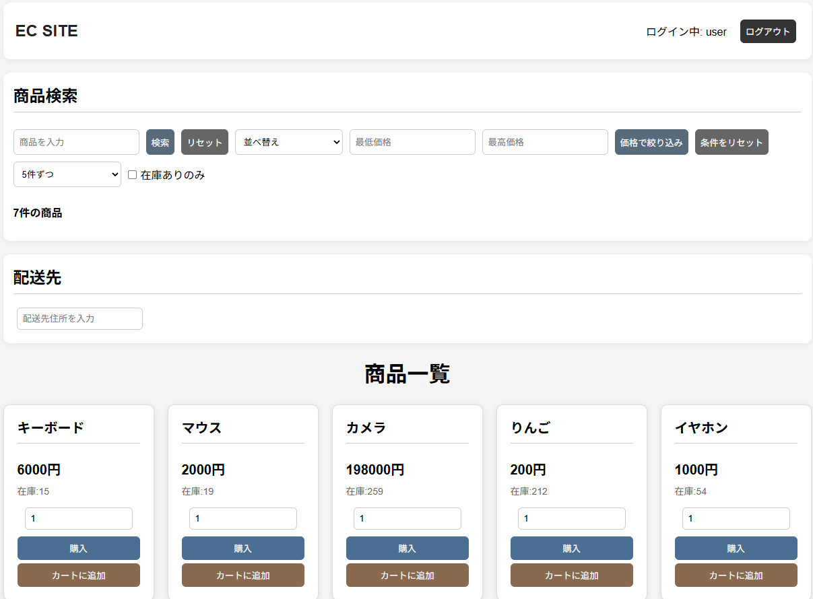
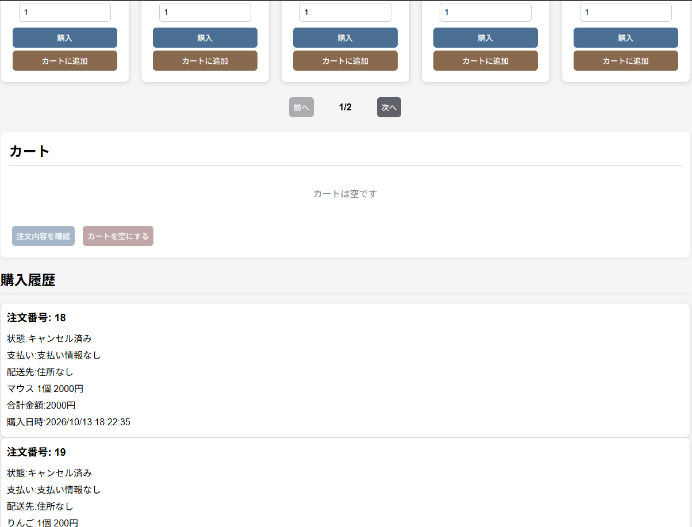
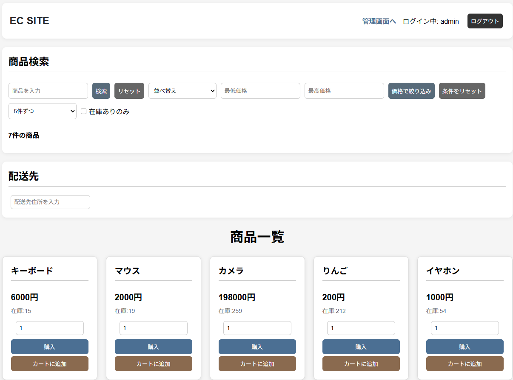
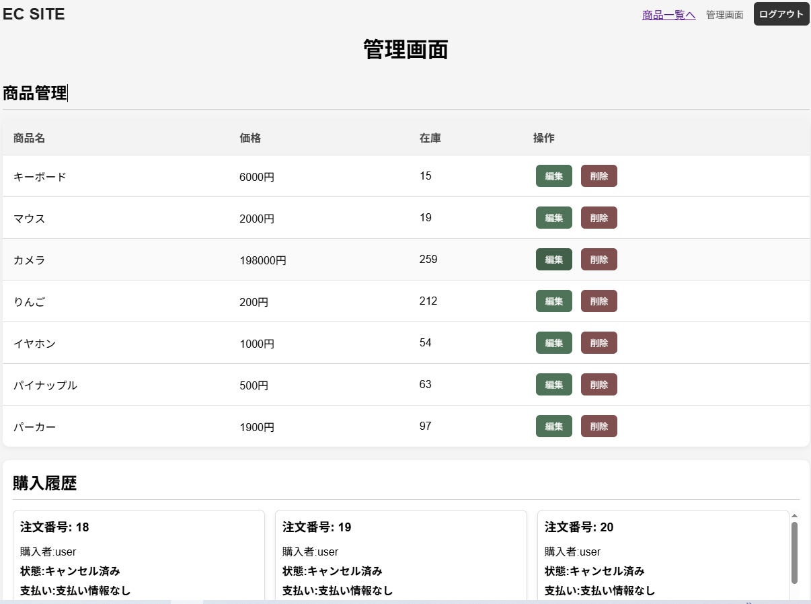
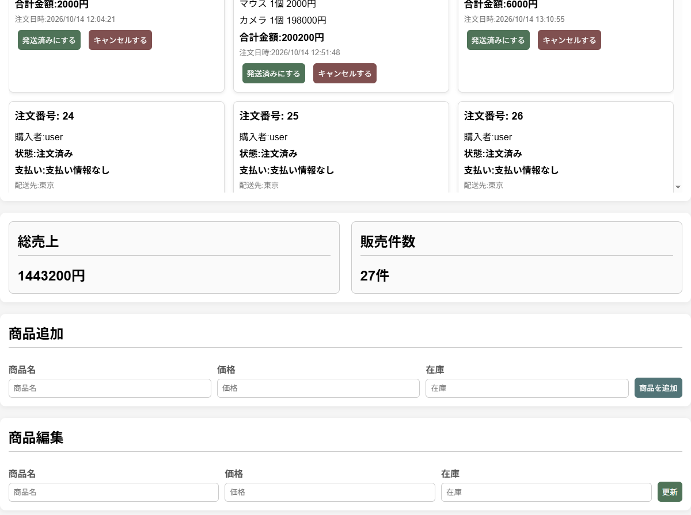

# ECサイト

Java / Spring Bootで作成した学習用ECサイトです。

## 公開URL

https://ecsite2-production.up.railway.app


## 主な機能

### ユーザー機能

- ユーザー登録
- ログイン / ログアウト
- 商品一覧表示
- 商品検索
- 価格範囲検索
- 在庫あり商品の絞り込み
- 商品の並び替え
- ページネーション
- 単品購入
- カート購入
- 注文内容確認
- 配送先住所の入力・保存
- 購入履歴の表示
- 疑似決済
- 支払い状態の表示
  - 未払い
  - 支払い済み
  - 返金済み

### 管理者機能

- 商品追加
- 商品編集
- 商品削除
- 注文履歴の確認
- 発送処理
- 注文キャンセル
- キャンセル時の在庫復元
- 支払い済み注文キャンセル時の返金済み処理

### セキュリティ

- Spring Securityによる認証
- USER / ADMINの権限管理
- 一般ユーザーから管理画面へのアクセス制限
- CSRFを有効にした状態でPOST / PUT / DELETEを実装
- 注文の支払い時にログインユーザー本人の注文か確認

## 使用技術

### バックエンド

- Java 17
- Spring Boot
- Spring Security
- Spring Data JPA
- Hibernate

### データベース

- MySQL
- H2（テスト用）

### フロントエンド

- HTML
- CSS
- JavaScript

### テスト

- JUnit
- Mockito

### その他

- Git / GitHub
- Railway

## 主なデータ構成

注文、販売履歴、支払い情報をそれぞれ分けて管理しています。

- `CustomerOrder`
  - 注文日時
  - 注文状態
  - 配送先住所
  - 注文ユーザー

- `Sale`
  - 商品
  - 購入数量
  - 購入時の商品名
  - 購入時の価格
  - 売上金額

- `Payment`
  - 注文
  - 支払い金額
  - 支払い状態

`CustomerOrder` と `Payment` は1対1で関連付けています。

### 在庫の整合性

購入時の在庫更新には悲観ロックを使用しています。

同じ商品に対して複数の購入処理が同時に行われた場合でも、
在庫数の不整合が起きにくいようにしています。

また、購入処理には `@Transactional` を使用し、
注文作成、在庫更新、販売履歴作成、支払い情報作成を
ひとまとまりの処理として扱っています。

### 注文単位での管理

カート内の商品を購入した場合でも、
複数の商品を1つの `CustomerOrder` として管理しています。

各商品については `Sale` を作成し、
すべて同じ注文に関連付けています。

### 購入時点の商品情報を保存

商品名や価格が後から変更されても購入履歴が変化しないように、
購入時点の商品名・価格を `Sale` に保存しています。

### 支払い情報の分離

支払い情報を注文とは別の `Payment` エンティティとして管理しています。

支払い状態は以下の3種類です。

- `UNPAID`
- `PAID`
- `REFUNDED`

支払い済みの注文をキャンセルした場合は、
注文状態をキャンセル済みに変更すると同時に
支払い状態を返金済みに変更します。

### キャンセル処理

注文をキャンセルした場合は、
その注文に含まれる `Sale` を取得し、
購入された数量分だけ商品在庫を元に戻します。

### 注文内容確認

単品購入・カート購入の両方で、
購入処理を実行する前に商品、数量、合計金額、配送先を確認できるようにしています。

数量や配送先を変更した場合は、
古い確認内容を誤って使用しないよう注文確認画面を非表示にします。

## テスト

JUnitとMockitoを使用して、
サービス層を中心に正常系・異常系のテストを実装しています。

主なテスト内容：

- 商品購入
- カート購入
- 在庫更新
- 発送処理
- キャンセル処理
- キャンセル時の在庫復元
- 支払い処理
- 他ユーザーによる支払いの拒否
- 支払い済み注文への再支払い防止
- 旧注文データの支払い情報移行

MockitoではRepositoryをMock化し、
`ArgumentCaptor`を使用して保存されるデータの内容も確認しています。

また、H2を使用した統合テストも実装しています。

## 開発環境

- Java 17
- Spring Boot
- Eclipse
- Visual Studio Code
- MySQL

## 起動方法

1. MySQLで `product_db` データベースを作成する 

2. `application.properties`　にMySQL接続情報を設定する

```properties
spring.datasource.url=jdbc:mysql://localhost:3306/product_db
spring.datasource.username=YOUR_USERNAME
spring.datasource.password=YOUR_PASSWORD
```

3. Spring Bootアプリケーションを起動する

Eclipseから `Ecsite2Application.java` を実行する。

4. ブラウザで以下にアクセスする

http://localhost:8080

## 今後追加したい機能

- Stripeなどを使った実決済機能
- DBマイグレーションツール (Flywayなど) の導入
- UI/UXの改善
## 画面イメージ

### トップページ





### 管理者トップページ



### 管理者ページ




